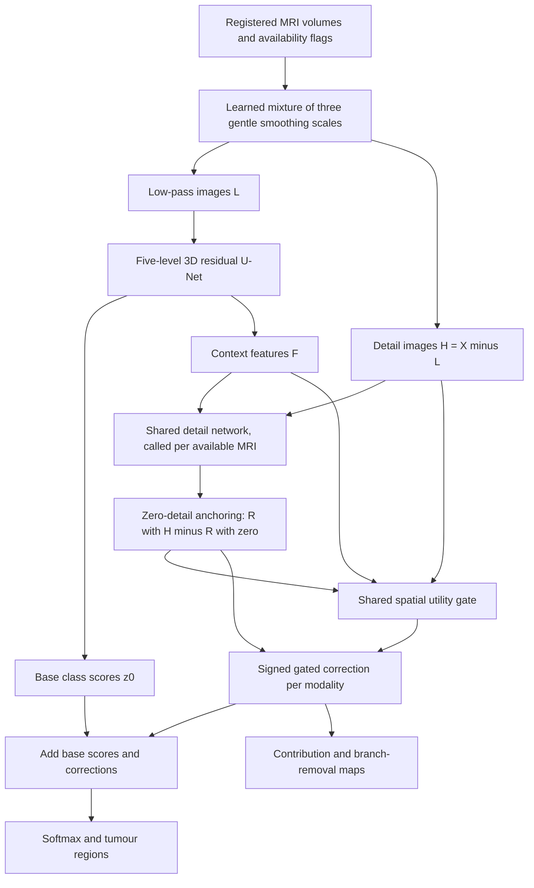

# DetailTrust-Net: brain tumour segmentation with attributable MRI-detail refinement

**Research design dated 12 October 2026.** This document recommends one architecture, explains its relationship to the eleven supplied papers, and specifies experiments that could establish or reject its contribution. It uses the journal PDFs in `papers/` as the main evidence. `notion.md` provides useful teaching context, but its statements are checked against the papers.


**Recommendation:** build a full five-resolution 3D residual U-Net that first predicts tumour regions from gently smoothed MRI. Give each available MRI a separate branch that proposes a correction using the image detail removed by smoothing. Train a gate to retain corrections that help segmentation. Add the retained corrections directly to the final class scores, so their numerical effect can be inspected and removed.

The working name is **DetailTrust-Net**. The name is a label for this proposal, not a claim of priority. The main implementation has **16,934,644 trainable parameters**, with a five-level backbone of widths **32, 64, 128, 256, 320**. Plan for one **T4 GPU**, a **96 × 96 × 96** starting patch, mixed precision, and batch size one. This is a research segmentation model, with no edge-device deployment requirement. Use smaller patient subsets to develop the method, then expand to the full training split. The parameter count follows from the exact layer specification below; GPU fit, training time, accuracy, and robustness remain unmeasured.

**Inspectable** refers to the output accounting: the contribution of a particular detail pathway can be displayed and removed exactly. It does not mean a toy model, and it does not imply that the internal U-Net is fully interpretable. Model capacity, explanation fidelity, and training cost are separate questions.

The relevant external critique is `detailtrust_consensus_review.md`. Its concerns about the split, reliability baselines, attribution, and hardware validation inform this revision. Section 16 records the response to each concern.

The defensible research question is:

> Can independently removable MRI-detail corrections, supervised by their measured segmentation benefit, improve robustness to missing and locally degraded sequences while exposing exactly how the detail pathways change the output?

The literature search found substantial overlap with each individual ingredient. It did not establish that this complete mechanism already exists, but it cannot certify worldwide novelty. In particular, CPLR-Net, MECS-Net, and GAUGE must be discussed. The contribution would depend on a useful, reproducible result from the specific design, rather than the mere combination of familiar modules.

## 1. Understand the task before the architecture

### 1.1 Segmentation is the task

We predict a label for each small 3D element of an MRI volume. That element is a **voxel**. A detection or classification model might answer whether an image contains a tumour; this model draws the tumour regions throughout the volume.

For an adult preoperative glioma dataset such as BraTS 2020, the four inputs are T1, post-contrast T1, T2, and FLAIR. They show the same anatomy with different image contrast. Post-contrast T1 is also called T1ce, T1c, or T1Gd.

| MRI sequence | Useful intuition | Qualification |
|---|---|---|
| T1 | Shows anatomical structure | It can also contain useful tumour information |
| T1ce | Shows contrast enhancement | Enhancement is an imaging observation; it is not a direct label for all aggressive or living tumour |
| T2 | Makes many water-rich structures bright | Brightness alone does not identify tumour |
| FLAIR | Suppresses normal cerebrospinal-fluid signal and helps show abnormal signal | FLAIR abnormality is not a pure measurement of edema or tumour cells |

The four scans must refer to matching physical locations. Stacking unregistered scans as channels creates false correspondences. The BraTS organisers provide registered, skull-stripped images resampled to a common resolution. Their labels distinguish enhancing tumour, edema, and necrotic/non-enhancing core. [BraTS 2020 data description](https://www.med.upenn.edu/cbica/brats2020/data.html)

### 1.2 Four exclusive labels, three evaluation regions

For BraTS 2020, use this internal mapping:

| Internal class | Meaning | Original label |
|---|---|---|
| 0 | Background | 0 |
| 1 | Necrotic/non-enhancing tumour core, NCR/NET | 1 |
| 2 | Peritumoral edema, ED | 2 |
| 3 | Enhancing tumour, ET | 4 |

The network predicts four mutually exclusive classes through a softmax. Derive the overlapping evaluation regions afterward:

- **ET:** class 3.
- **TC, tumour core:** classes 1 and 3.
- **WT, whole tumour:** classes 1, 2, and 3.

Thus ET is contained in TC, and TC is contained in WT by construction. These are set relationships; an individual tumour need not look like three neat concentric rings. Check the label specification again if using a different BraTS release or task.

### 1.3 Missing information and damaged information differ

An absent T1ce scan removes a measurement that can be important for identifying enhancement. A model may infer correlated patterns from other sequences, but it has not observed the missing enhancement. There is no universal Dice ceiling for this setting.

A present scan can also contain damaged regions. For example, one FLAIR area may be blurred while another still has useful boundaries. A whole-sequence availability flag cannot describe that local difference.

Our design therefore uses both **availability flags** and **spatial detail gates**. It still cannot recover information that no available scan contains. BraTS glioma results also do not establish performance on every brain tumour type, postoperative scan, or screening population.

## 2. Which supplied files were reviewed

The folder contains **13 PDFs representing 11 principal works**. The descriptively named MoME and HFF-Net PDFs are earlier preprints. Their journal versions contain additional material and take precedence here. PDF page numbers below count from the first page of each local file.

| ID | Local journal PDF | Paper and publication | Main evidence locations |
|---|---|---|---|
| P1 | `IEEE Xplore Full-Text 1.pdf` | D²-Net, TMI 2022 | Method pp. 3–6; implementation p. 7; limitations p. 11 |
| P2 | `IEEE Xplore Full-Text PDF_2.pdf` | Learning Unified Hyper-Network, TMI 2023 | Architecture/method; implementation p. 7; conclusion p. 11 |
| P3 | `IEEE Xplore Full-Text PDF_3.pdf` | Mixture of Modality Experts, TMI 2025 | Method pp. 3–5; MoME+ extension; experiments and conclusion |
| P4 | `IEEE Xplore Full-Text PDF_4.pdf` | Rethinking Brain Tumor Segmentation From the Frequency Domain Perspective, TMI 2025 | FDD/ALC/FDCA/DFL method; implementation p. 8; Section IV-C.5 and Fig. 11 |
| P5 | `IEEE Xplore Full-Text PDF_5.pdf` | MBUNeXt, TNNLS 2025 | Method from p. 4; Section IV-G, pp. 11–12 |
| P6 | `IEEE Xplore Full-Text PDF_6.pdf` | Medical Transformer, TNNLS 2024 | Section III; transfer-learning experiments; conclusion p. 10 |
| P7 | `IEEE Xplore Full-Text PDF_7.pdf` | SwinPA-Net, TNNLS 2024 | Section II from p. 3; implementation p. 7 |
| P8 | `IEEE Xplore Full-Text PDF_8.pdf` | Multimodal Feature Distillation With Mamba-Transformer, TAI 2026 | Method from p. 3; implementation p. 8; conclusion p. 13 |
| P9 | `IEEE Xplore Full-Text PDF_9.pdf` | M²FTrans, JBHI 2024 | Method from p. 3; implementation p. 6; Section V-G p. 11 |
| P10 | `IEEE Xplore Full-Text PDF_10.pdf` | DCTC-Net, TNNLS 2026 | Method from p. 3; implementation p. 9; conclusion pp. 13–14 |
| P11 | `IEEE Xplore Full-Text PDF_11.pdf` | M²SegMamba, JBHI 2026 | Method from p. 3; implementation p. 7; discussion pp. 10–11 |

Publication years refer to the journal issue. Some DOIs carry an earlier online-publication year. The bibliography in Section 17 provides the verified DOI identifiers.

In the following summaries, **reported limitation** means the authors discuss it. **Design inference** means an implication drawn for this project, not a failure demonstrated by that paper.

## 3. What the eleven papers do, how they do it, and what we learn

### P1. D²-Net: separate tumour information from modality information

**Problem.** Different MRI sequences carry related tumour information, but also have sequence-specific appearance. Missing a sequence can disrupt a model that entangles those two things.

**Mechanism.** D²-Net learns a tumour representation and modality representations through separate encoding paths. Its spatial-frequency joint modality contrastive learning encourages useful separation of modality characteristics. A reconstruction pathway combines the representations. It also transfers region-specific knowledge into a holistic segmentation pathway through affinity-guided distillation. Affinity describes relationships between features, so the student learns relationships as well as individual predictions.

**Student explanation.** Separate what describes the lesion from what describes the camera setting. Then use region-focused training signals to improve the final segmentation.

**Reported limitation.** The discussion describes difficulty with enhancing tumour when T1ce is unavailable and considers further use of complete-modality knowledge. This is evidence of a specific information problem, not proof of a universal performance limit.

**Lesson for our design.** Frequency information and missing modalities already appear together here. We cannot claim that pairing as new. Our proposed difference is an explicit final-score contribution from each detail pathway, with utility targets computed by switching that pathway off. D²-Net's disentanglement and distillation objectives are not that mechanism. [P1 DOI](https://doi.org/10.1109/TMI.2022.3175478)

### P2. Unified Hyper-Network: adapt synthesis and segmentation to the available scans

**Problem.** Training a separate system for every possible missing-sequence combination is inconvenient. Four modalities produce fifteen nonempty combinations.

**Mechanism.** A hyper-network generates or modulates parameters of another network according to the modality configuration. The paper separates shared and modality-specific information, combines features through graph attention, and uses image synthesis and feature completion to support segmentation. Its design adapts processing to the available inputs instead of keeping separate models for every combination.

**Student explanation.** A small controller adjusts the processing machinery when the set of scans changes. The system learns to fill information gaps before drawing the final regions.

**Resource evidence.** The reported segmentation configuration uses a 24 GB RTX 3090, 72³ patches with batch size two, and a 1,200-epoch schedule. The paper reports 32.49 million segmentation parameters and approximately 16 GB memory for that configuration. These figures describe its implementation and cannot be converted into our training time.

**Design inference.** Synthesis, adversarial constraints, and parameter generation give a student more components to debug. They also do not establish that inferred contrast is an observed measurement. We choose a direct segmenter whose output records what its detail pathways changed. This is a scope and resource choice, not a claim that synthesis is ineffective. [P2 DOI](https://doi.org/10.1109/TMI.2023.3301934)

### P3. MoME and MoME+: learn several modality experts

**Problem.** Brain lesion datasets differ in modality, lesion type, and available labels. A universal model needs to accommodate these differences.

**Mechanism.** MoME develops modality experts and learns how to combine their features. The training curriculum first encourages specialization and then coordinated use of experts. The journal version extends this to **MoME+**, using soft dispatch and modality dropout to accept combinations of modalities. The experts are based on nnU-Net.

**Student explanation.** Train readers with different experience, then learn which readers to consult for the supplied scans. MoME+ also decides how multiple scans should reach those readers.

**Important correction.** It would be wrong to claim that this paper handles only one input scan or ignores missing modalities. That would overlook the journal extension.

**Resource evidence and design inference.** The paper reports large, multi-dataset training and an 800-epoch schedule on A100 GPUs. Reproducing its foundation-model training is a different project from our Kaggle prototype. An expert weight also does not, by itself, prove a particular final class-score contribution. We borrow the idea that modality identity matters, while sharing one tiny detail network across the four sequences. [P3 DOI](https://doi.org/10.1109/TMI.2025.3540809)

### P4. HFF-Net: separate broad image structure from fine detail

**Problem.** Broad tumour layout and subtle boundaries need different representations. Fine details can disappear during ordinary feature extraction.

**Mechanism.** HFF-Net decomposes inputs using frequency transforms, including dual-tree complex wavelets and a nonsubsampled contourlet transform. It processes low- and high-frequency components in separate paths. Adaptive Laplacian convolution starts from an edge-sensitive operator and uses a Fisher-information-based regularizer. Frequency-domain cross-attention exchanges information, and its dual-domain frequency loss aligns branch learning.

**Student explanation.** Study the broad shapes and the fine changes separately, then combine them to improve the tumour outline.

**Reported limitation.** Section IV-C.5 and Fig. 11 discuss failures associated with degraded FLAIR information. The authors note that their frequency decomposition applies uniformly to modalities and suggest reliability weighting, attention masking, or uncertainty-aware approaches as future directions.

**Consequence for novelty.** A proposal that says “add reliability to HFF-Net” follows an already identified direction. Our claim must concern the specific removable correction mechanism and its training, with direct experiments against ordinary gates.

**Resource lesson.** The reported 128³, batch-one configuration runs on an RTX 4090 with 24 GB. We retain a simple structure/detail distinction, using one Gaussian residual split and a full residual U-Net. Gaussian smoothing is not equivalent to HFF-Net's richer decomposition. [P4 DOI](https://doi.org/10.1109/TMI.2025.3579213)

### P5. MBUNeXt: combine modality features at several depths

**Problem.** MRI sequences provide complementary information at different feature scales. A single fusion operation can fail to use that information well.

**Mechanism.** MBUNeXt has separate modality encoders and a shared decoding path. Multimodal feature attention, MFA, emphasizes useful relationships. Multibranch encoder aggregation, MEA, combines representations across branches. Large-kernel convolutional skip processing, LCS, passes spatial information to the decoder. Layer fusion lets modalities interact at several stages.

**Student explanation.** Each scan has its own feature extractor. The model repeatedly compares their notes, and the decoder receives both detailed and broader information.

**Reported limitation.** Section IV-G says that the requirement for aligned multimodal inputs limits direct use with single-modality datasets. It identifies compatibility with missing and partially incomplete modalities as future work.

**Important qualification.** The experiments include BraTS-Africa 2024 as well as BraTS 2019 and 2021. It would be inaccurate to say the authors made no attempt to investigate broader data variation.

**Lesson for our design.** A modality can make a useful distinct contribution, but four full encoders increase cost. We keep modality identity in four calls to a shared small network. We also define missing-input behavior explicitly. [P5 DOI](https://doi.org/10.1109/TNNLS.2025.3593297)

### P6. Medical Transformer: learn a reusable brain representation from slices

**Problem.** Medical labels are limited, and full 3D representation learning can be expensive.

**Mechanism.** The authors view a volume through axial, coronal, and sagittal slices. A convolutional encoder learns slice appearance, including a triplet-loss pretraining step. A transformer learns relationships between slice representations through a masked-vector prediction task. They then fine-tune for classification, regression, and segmentation.

**Student explanation.** Learn individual pages of a three-dimensional book, learn how the pages fit together, and reuse that knowledge for a labelled task.

**Design inference.** This paper addresses transferable representation learning. Its results do not establish the specific combination of arbitrary missing sequences, locally damaged details, and exact final-score attribution that we propose to study. It should not be dismissed simply because it contains a transformer: parameter efficiency is one of its stated benefits.

**Lesson for our design.** Separate the useful research question from the fashionable backbone. We use small 3D patches because the target is volumetric delineation and the initial experiment does not need a separate healthy-brain pretraining corpus. A 2.5D alternative remains a resource fallback, but would require a new protocol and comparison. [P6 DOI](https://doi.org/10.1109/TNNLS.2023.3308712)

### P7. SwinPA-Net: combine features across image scales

**Problem.** Lesions vary in size, and local boundaries can be difficult to distinguish from surrounding tissue.

**Mechanism.** A Swin Transformer extracts features using regular and shifted windows. Dense multiplicative connections combine multiscale information. Local pyramid attention helps integrate context and spatial detail in the decoding process.

**Student explanation.** Look at an image at several zoom levels and learn how those views should cooperate when drawing the outline.

**Evidence boundary.** Its experiments concern polyp, skin-lesion, and laparoscopic imagery. This is useful medical segmentation work, but it is not direct evidence for a four-sequence 3D brain tumour model under missing inputs. The implementation resizes images to 384 × 384 and uses a 3090 GPU.

**Lesson for our design.** A U-Net already supplies a simple multiscale path. We use that familiar structure before adding another attention hierarchy. Attention can improve a model, but an attention map alone is insufficient to identify the exact amount by which a modality changed a final prediction. That observation motivates our output-level accounting. [P7 DOI](https://doi.org/10.1109/TNNLS.2022.3204090)

### P8. MMTSeg: transfer complete-modality knowledge and fuse through Mamba–Transformer blocks

**Problem.** A model trained on incomplete inputs needs useful individual representations and cooperation among the available modalities.

**Mechanism.** The supplied journal version uses multimodal feature distillation, MFD, to transfer complementary full-input information to individual modality pathways. Unimodal feature enhancement, UFE, models local and broader relationships. Cross-modal fusion, CMF, combines the modality representations through hybrid Mamba–Transformer processing. Auxiliary segmentations and a boundary-aware loss supply training signals.

**Student explanation.** A reader with all the scans teaches readers with fewer scans. The readers improve their own features and then combine them.

**Resource evidence.** The implementation describes 128³ patches, batch size one, and 1,000 epochs. The architecture also contains auxiliary encoding/decoding paths used for training.

**Reported limitation and design inference.** Its conclusion discusses the limited exploration of hybrid configurations and the brain-MRI task scope. For our project, the training branches and hybrid processing add implementation and explanation cost. That does not establish inferior accuracy or efficiency on identical hardware.

**Lesson.** We do not need to copy the whole teacher–student system to obtain supervision about a correction: labelled training images let us measure whether adding a fixed correction helps the current prediction. [P8 DOI](https://doi.org/10.1109/TAI.2026.3678550)

### P9. M²FTrans: mask unavailable modalities and rebalance fusion

**Problem.** A network may overuse a dominant modality and struggle when it disappears.

**Mechanism.** Each modality has an encoder. A shared regularization decoder encourages individual modalities to learn useful segmentation features. Modality-masked fusion transformers use learned fusion tokens while excluding unavailable inputs. Spatial weight attention and channel-wise fusion transformers reweight features.

**Student explanation.** Give each scan a voice, prevent the absent scans from participating, and learn how to combine the remaining information.

**Reported limitation.** Section V-G notes that stronger gains with fewer modalities may accompany weaker use of dominant modalities when more inputs are present. It also says model efficiency was not the major focus.

**Resource evidence.** The implementation specifies 80³ crops, batch size two, two 24 GB RTX 3090 GPUs, and 1,000 epochs. The crop size is 80³ in this journal PDF; it should not be reported as 128³.

**Lesson.** Availability masks and spatial reweighting are established ideas. We need a stronger comparison than a naïve model that has never seen missing inputs. M²FTrans is a relevant external comparator, and a matched U-Net with modality dropout is the essential low-cost baseline. [P9 DOI](https://doi.org/10.1109/JBHI.2023.3326151)

### P10. DCTC-Net: coordinate convolutional and transformer features

**Problem.** Local shape variation and broader image relationships can require different processing.

**Mechanism.** DCTC-Net places CNN and transformer processing in parallel. Dynamic deformable convolution adapts local sampling. Windowed and shifted-window adaptive complementary attention captures spatial, channel, and cross-dimensional relationships. A lightweight perceptron module reduces part of the transformer cost.

**Student explanation.** One path follows local patterns and shape changes; another compares broader relationships. Cross-fusion lets them help each other.

**Evidence boundary.** The reported evaluations include ISIC2018, LiTS liver, and ACDC cardiac segmentation. This does not validate the model on our incomplete multimodal brain-tumour protocol.

**Reported limitation.** The discussion calls for broader generalization tests, further compression for constrained devices, and anatomical priors to strengthen robustness and interpretation.

**Lesson.** Parallel paths can have understandable roles, but a CNN–Transformer combination is already established. Our paths have a more restrictive contract: the detail branch must produce a removable change to the final score, and its correction must vanish when its detail input is zero. [P10 DOI](https://doi.org/10.1109/TNNLS.2025.3628995)

### P11. M²SegMamba: learn from unlabelled structure before using scarce labels

**Problem.** Some projects have few labelled subjects and incomplete MRI inputs.

**Mechanism.** The first phase masks features within and across modalities and reconstructs them. Modality-specific CNN–Mamba encoders and multimodal traversal orders model spatial and modality relationships. Fine-tuning adds segmentation supervision. Tri-orientated spatial Mamba blocks combine skip features, and auxiliary regularizers reduce dependence on dominant modalities.

**Student explanation.** First practise filling in hidden parts of the training scans. Then use labels to learn tumour regions from the representation developed during that practice.

**Important correction.** The method does not require the large full-modality teacher suggested in some simplified accounts. Its main recipe uses masked pretraining followed by supervised fine-tuning.

**Resource evidence.** The paper describes 300 pretraining epochs followed by 1,000 fine-tuning epochs. Its small-labelled-data experiments still use all training images without labels for pretraining. Label efficiency and total compute are different quantities.

**Lesson.** Few-shot learning is already an active direction. We choose a supervised prototype with a smaller experimental burden. If we later use unlabelled pretraining, it must be disclosed and supplied fairly to comparison methods. [P11 DOI](https://doi.org/10.1109/JBHI.2025.3600652)

## 4. Additional literature that changes the novelty claim

This was a targeted novelty search, not an exhaustive systematic review. Searches covered frequency and missing-modality segmentation; corruption-aware fusion; additive logit refinement; modality contribution measurement; and counterfactual evidence gating. The cutoff is 12 October 2026. The following primary sources constrain the proposal.

| Work | Relevant existing idea | Consequence for this project |
|---|---|---|
| [PF-CMNet](https://pmc.ncbi.nlm.nih.gov/articles/PMC13297487/) | Frequency-aware cross-modal processing, progressive decoding, and missing-modality distillation | Combining frequency features with incomplete MRI is already addressed |
| [AMGFormer, preprint](https://arxiv.org/html/2601.19349v1) | Adaptive multimodal gating, including modality-quality scoring | A generic quality gate is insufficient novelty |
| [CoReFuse-Med, preprint](https://arxiv.org/html/2609.10261v1) | Investigates fusion failure under aligned quality discrepancies; suppresses shallow corruption and rebalances deeper fusion | Present-but-degraded MRI and harmful fusion are already studied |
| [CPLR-Net](https://www.mdpi.com/2073-8994/18/8/1261) | Coarse logits plus a gated additive residual for brain tumour segmentation | Coarse-to-fine logit correction is already addressed |
| [MECS-Net](https://doi.org/10.1016/j.eswa.2026.131396) | Sample-level modality contribution measurement, resampling of low-contribution modalities, edge features, and cross-attention/Mamba fusion | Measuring modality usefulness is already addressed |
| [GAUGE, preprint](https://arxiv.org/abs/2608.05608) | Fine-grained counterfactual evidence gating for incomplete multimodal classification; Taylor estimates modulate attention | Counterfactual gating itself is already addressed, including efficient approximations |
| [LoMix, preprint](https://arxiv.org/html/2510.22995v1) | Learns mixtures/supervision of multiscale logits | Learned logit combinations and independent weights are established |
| [Shen and Gao, IPMI 2019](https://arxiv.org/abs/1904.07290) | Missing-modality training and maps of positive/negative modality influence through removal | Modality-removal explanation is not new |
| [Sequence dropout study](https://pmc.ncbi.nlm.nih.gov/articles/PMC10501967/) | Improves missing-sequence robustness by changing training of a conventional segmenter | A strong plain backbone is a necessary baseline |
| [SIUM, MICCAI 2026](https://papers.miccai.org/miccai-2026/0949-Paper1877.html) | Set-inclusive uncertainty modelling for missing-input segmentation | Adding an uncertainty head does not establish novelty |
| [Deep evidential fusion, Information Fusion 2025](https://doi.org/10.1016/j.inffus.2024.102648) | Learned modality/class reliability and decision-level evidence fusion | Reliability learning and even an additive score interpretation have close precedent |
| [SwitchNet, JBHI 2026](https://pubmed.ncbi.nlm.nih.gov/41701593/) | Adaptive encoder/decoder switching and a guide-contribution mechanism | Training-time modality contribution analysis is already a stated aim; full-method comparison remains needed |
| [M3AE, AAAI 2023](https://ojs.aaai.org/index.php/AAAI/article/view/25253) | Multimodal masked representation learning for missing MRI | Treat it as a peer-reviewed conference paper, not merely an arXiv record |
| [No Modality Left Behind, Medical Image Analysis 2026](https://doi.org/10.1016/j.media.2026.104108) | Knowledge distillation and modality-specific adaptation | A current strong comparator for incomplete MRI, beyond older fusion baselines |

For CPLR-Net, accessible publisher-indexed descriptions include the logit-update equations. For MECS-Net, the accessible publisher abstract, introduction, and conclusion establish the contribution-measurement mechanism, but its complete methodological details were not available in this pass. Obtain those details before a priority claim or submission. Do not turn a missing full text into an assertion that the method lacks a particular component.

The narrow distinction worth testing is the following **joint design**:

1. Keep a shared low-pass context path and separate modality-detail correction paths.
2. Make each correction zero when its detail input is zero, and independently removable from the final scores.
3. Freeze those corrections before learning spatial gates from exact labelled switch-off comparisons, computed without extra backbone evaluations.
4. Evaluate both segmentation robustness and the fidelity/usefulness of the exposed corrections at a small compute budget.

CPLR-Net threatens the residual-refinement part; MECS-Net threatens contribution-based learning; GAUGE threatens fine-grained utility gating. The proposal needs to demonstrate a benefit from its particular restrictions. A change of dataset or acronym would not be enough.

An equation-level check makes the evidential-fusion overlap stronger than the Consensus summary suggests. In its Eq. (10), the class probability is proportional to a product of modality terms `t_m,k = 1 − β_m,k + β_m,k pl_m,k`. Therefore it can be written as `softmax_k(Σ_m log(t_m,k))` when those terms are positive. This additive score interpretation follows algebraically; it is not a new property unique to DetailTrust-Net. The paper's learned reliability coefficients are modality/class parameters, while voxelwise evidence varies with the image. Our proposed spatial utility supervision and anchored detail corrections remain different mechanisms to investigate. [Author-hosted evidential-fusion manuscript, Section 3.1.3](https://www.hds.utc.fr/~tdenoeux/dokuwiki/_media/en/publi/deep_fusion_v3.pdf)

Accordingly, **exact additivity and a margin calculation are enabling properties, not sufficient novelty claims**. The central candidate contribution is learning the local usefulness of zero-detail-anchored corrections under incomplete and degraded MRI, with controlled evidence that this helps more than ordinary spatial gating.

## 5. Brainstorming and selection

The selection criteria are practical: a clear unsatisfied need, distinguishability from close work, a mechanism a student can derive, and experiments affordable on one small GPU. Ratings below are judgments for this project, not measured scores.

| Candidate | Attraction | Main obstacle | Decision |
|---|---|---|---|
| 1. CNN + Swin + Mamba fusion | Several representation types | Crowded, harder to explain, costly ablations | Reject |
| 2. HFF-Net with modality dropout | Simple connection between two supplied ideas | D²-Net and PF-CMNet already overlap | Baseline only |
| 3. Global quality gate per MRI | Cheap and intuitive | AMGFormer and other fusion work overlap; local damage gets averaged | Comparator |
| 4. Local frequency-quality gate inside U-Net features | Keeps undamaged detail | Close to quality/frequency fusion; latent weights give weak output explanations | Shortlist |
| 5. Uncertainty head for absent T1ce | Important clinical measurement gap | Substantial prior work; calibration is an additional research burden | Defer |
| 6. Recover missing T1ce with a generator | Familiar image-to-image task | Synthesis can suggest unobserved detail; extra model/training | Reject for this project |
| 7. Compact 2.5D slice-context network | Lower memory | Generic architecture change; through-plane consistency needs work | Resource fallback |
| 8. Masked pretraining with Mamba | Could reduce labels needed | M²SegMamba and related work already address it | Reject as core novelty |
| 9. Left-right brain symmetry correction | Easy anatomical intuition | Tumours distort anatomy; bilateral lesions and symmetry methods complicate claims | Defer |
| 10. Monotonic confidence as modalities increase | Simple missing-input intuition | A newly added damaged scan can make the decision worse; related uncertainty work exists | Reject hard constraint |
| 11. Corruption benchmark with an ordinary U-Net | Cheap and valuable if carefully designed | Primarily an evaluation contribution; less architectural novelty | Keep as experimental foundation |
| 12. Removable detail corrections with supervised utility gates | Small, exact output accounting, local suppression | Narrow novelty; additive restriction may reduce accuracy | **Select** |

The finalists are candidates 3, 4, 7, and 12. Candidate 3 supplies the simplest gate comparison. Candidate 4 may be more expressive but makes explanation harder to verify. Candidate 7 prioritizes memory over the selected research question. Candidate 12 connects a useful training signal, a restricted architecture, and a checkable explanation without requiring another large model.

### The gap stated with the right scope

The reviewed work leaves room to investigate **low-cost, explicitly attributable detail refinement under joint sequence absence and spatial degradation**. This is a candidate intersection of requirements, not proof that no earlier paper meets it.

The main hypothesis is that learning when a fixed detail correction helps will reduce harmful refinements beyond what equal-capacity segmentation training and corruption augmentation already achieve. A second hypothesis is that the additive restriction gives usable explanations without a large accuracy penalty. Either hypothesis can fail.

## 6. The supplied loss review and the physics direction

### 6.1 What the added references establish

The pasted review contains useful pointers, but some preview titles describe different articles from the actual links. Use the publication record, not the preview image, as the citation source.

| Supplied reference | Verified interpretation | How it affects this design |
|---|---|---|
| [Visalakshi and Mohan, 2025](https://www.nature.com/articles/s41598-025-33136-x) | Proposes a sub-differentiable Hausdorff-style objective with BCE | Boundary plus region loss is established. Its point-set equations also require care when translating gradients into a voxelwise network |
| [QU-BraTS](https://pmc.ncbi.nlm.nih.gov/articles/PMC10060060/) | A benchmark for uncertainty estimation in brain tumour segmentation | Evaluate the relationship between uncertainty and errors; a good Dice score does not establish good uncertainty |
| [Zhou et al., Information Fusion 2026](https://doi.org/10.1016/j.inffus.2025.104085) | Multimodal teacher–student fusion and an uncertainty-aware objective | Generic uncertainty-weighted fusion/loss is not an open novelty claim |
| [MRI-based brain tumour segmentation systematic review, 2022](https://pubmed.ncbi.nlm.nih.gov/35340900/) | Historical survey of segmentation methods | Useful background, insufficient for an October 2026 novelty decision |
| [Expert-centered evaluation, 2024](https://pubs.rsna.org/doi/10.1148/ryai.220231) | Studies expert assessment of segmentation quality | Include boundary and case-level failure analysis; avoid equating one metric with clinical usefulness |
| [Recent advances review, 2026](https://doi.org/10.1016/j.engappai.2026.114473) | Reviews self-supervised, federated, and graph-based segmentation directions | Supports testing small regions and dataset shift; it does not validate our proposed mechanism |

There is more direct overlap with the suggested annotation-disagreement gap. **Probabilistic Multi-rater Segmentation via Style-Aware Boundary Conditioning**, MICCAI 2026, explicitly introduces a disagreement-aware boundary loss. Earlier **Learning from multiple annotators for medical image segmentation** also models annotation variability. The broad idea in Gap 1 therefore already has close prior art. [MICCAI 2026 paper](https://papers.miccai.org/miccai-2026/paper/5829_paper.pdf), [earlier multi-annotator work](https://pmc.ncbi.nlm.nih.gov/articles/PMC10533416/)

For the supplied formula, `a_i` is the fraction of positive votes; `c_i = |2a_i - 1|` is a consensus-strength score. With only one annotation, `c_i = 1` everywhere, so it contains no disagreement information. Two agreeing annotators and ten agreeing annotators also get the same score despite different evidence strength. At a 50:50 boundary, the proposed weight removes that boundary's contribution entirely, which can suppress learning on small ambiguous lesions.

BraTS labels may have undergone review by several experts without distributing every expert's original mask. Verify the actual downloaded files before planning a multi-rater experiment. Ensemble disagreement and synthetic boundary perturbations can support separate experiments, but neither is a measurement of real expert disagreement.

**Decision:** keep a standard region loss for the core model, introduce utility supervision for the specific gate question, and compare an established boundary objective as an ablation. Do not add an unsupported multi-annotator term to the default recipe.

### 6.2 Physics has to specify a variable, an equation, and evidence

There are two distinct routes:

**Acquisition physics:** how tissue and scanner settings produce an image. A simplified image-space model is

`X_m = R_m(S_m(K_m * I_m)) + noise_m`,

where `I_m` is the ideal contrast image, `K_m` describes spatial blurring, `S_m` samples it on the acquired grid, and `R_m` represents reconstruction/resampling onto the working grid. A **point-spread function**, or PSF, describes how an ideal point spreads in the image. Thick slices can mix signals from different tissues. This model omits many scanner and reconstruction effects; it is not a full MRI simulator.

Physics-informed MRI segmentation with acquisition parameters already exists. SynthSeg also uses simulated contrast and resolution variation, including slice-profile blur. These are precedents, not new contributions of this proposal. [Borges et al.](https://arxiv.org/abs/2001.10767), [SynthSeg](https://pmc.ncbi.nlm.nih.gov/articles/PMC10154424/)

**Tumour-growth biophysics:** how a hypothetical cell-density field changes through time. A common schematic equation is

`∂u/∂t = ∇ · (D ∇u) + ρ u(1 − u)`.

Here `u` means cell density, `D` controls spread, and `ρ` controls proliferation. A segmentation class probability is not automatically cell density. A static label map does not directly measure its time derivative, and optimizer steps are not elapsed biological time. Inverse inference from a snapshot is possible only with additional modelling assumptions and an observation model.

This route also has direct prior art: **Biophysics Informed Pathological Regularisation for Brain Tumour Segmentation**, MICCAI 2024, incorporates growth-model regularization. **Physics-informed DynUNet for brain metastasis segmentation** is another relevant 2026 record. Adding a reaction–diffusion residual would need comparison with such work and justification for the tumour population. [MICCAI 2024](https://papers.miccai.org/miccai-2024/103-Paper2262.html), [PI-DynUNet publisher record](https://www.sciencedirect.com/science/article/abs/pii/S0169260726002117)

### 6.3 The physical connection selected for this model

Use **acquisition-inspired degradation** to test and train the detail pathways. Simulate slice blur and lower sampling resolution before returning the scan to its original grid. Keep the segmentation target aligned. This creates a concrete question: does the model retain useful information while reducing damage from degraded image detail?

The custom detail module also obeys an exact architectural rule: its output is zero when its detail input is zero. That is a signal-support constraint. It makes the source of the correction more traceable, but it is not a law of MRI physics or a guarantee against false tumour predictions.

Do not call the default model a physics-informed neural network. It is an **acquisition-aware segmentation proposal with constrained detail refinement**. If the project later has quantitative T1/T2 maps, acquisition parameters, or raw measurements, a stronger forward-model constraint becomes possible.

### 6.4 Optional resolution-matched supervision, kept separate from the core claim

For a simulated coarse acquisition grid, define a fixed positive averaging operator `A_s`. Each row sums to one. Applying it to one-hot labels gives the fraction of each class within a coarse sampling footprint:

`Y_s = A_s one_hot(Y)`, and `P_s = A_s softmax(z)`.

An auxiliary objective is `L_res = −mean Σ_k Y_s,k log(P_s,k + ε)`.

This checks regional occupancy at the resolution used in the simulation. Keep the normal high-resolution segmentation loss as well, because coarse supervision alone could erase small ET regions. Apply it only to synthetic resolution-degradation batches whose operator is known. For a first ablation use weight 0.1 and compare weight zero; that value is a starting setting, not an optimum.

This is a **resolution-aware auxiliary loss**, with conceptual overlap with partial-volume methods. It does not claim that MRI intensity is a linear mixture of our four segmentation probabilities, and its performance is unknown. Compare it with ordinary multiscale supervision before treating it as a contribution. [PV-SynthSeg](https://arxiv.org/abs/2004.10221)

## 7. The single proposed architecture

### 7.1 Explain it in one minute

The main network draws an initial tumour segmentation from gently smoothed versions of the available MRI scans. A separate detail pathway examines what smoothing removed from each scan and proposes changes to the class scores. A learned spatial gate decides how much of each proposed change to apply. The final output is the initial score plus those retained corrections.

During training, we can compare a score with and without one correction against the label. That comparison teaches the gate which corrections help. During inference, the model predicts the gates from the images; it receives no label.

### 7.2 Information flow



### 7.3 Step 1: say which scans are present

Let `a_m` be one if modality `m` is available and zero otherwise. There are four flags, ordered `[T1, T1ce, T2, FLAIR]` throughout the implementation.

After normalization, fill absent inputs with zero and supply the four flags as broadcast channels. A zero-valued voxel can occur in a real normalized image, so the flag carries separate information. Reject the all-missing case. No segmentation method has image evidence in that case.

**Why:** the model must distinguish an absent scan from a present scan containing low or zero intensities.

### 7.4 Step 2: separate smooth appearance from residual detail

Use three fixed Gaussian kernels, with sigmas **0.5, 0.8, and 1.2 mm**. Learn three global mixing logits per modality, totalling twelve parameters:

`w_m = softmax(α_m)`

`L_m = Σ_s w_m,s GaussianBlur(X_m; σ_s)`

`H_m = X_m − L_m`.

On 1 mm data use nine-tap separable kernels, reflection padding, and normalization to unit sum. Convert sigma from millimetres to voxels if spacing differs, and use a support radius of at least three times the largest voxel-space sigma. Initialize each modality's mixing logits to `[-1, 1, -1]`, which favors 0.8 mm without forcing it. Learn them during the first two training stages and freeze them with the backbone for gate training.

These weights are shared across subjects and positions for a given modality. They do not inspect the current image to select a separate filter at every voxel. This keeps the split understandable and prevents an additional attention network from becoming part of the explanation.

**Why revise the fixed split:** the Consensus critique correctly observes that no evidence yet establishes 0.8 mm as the best scale. The mixture allows limited data-driven choice while retaining a positive normalized smoothing operator. Learned smoothing is also established; it is an engineering hypothesis, not a separate novelty claim. Compare it with a fixed 0.8 mm split, a raw-input residual model, and a wavelet split under the same protocol. Retain this choice only if those experiments support it.

The identity `X_m = L_m + H_m` holds up to floating-point error. We do not discard the residual from the complete model. However, separating its processing from the context path changes the model's representational freedom and can hurt accuracy; that needs an ablation.

**Why:** isolate broad appearance and local changes so the detail pathways have a concrete input meaning. Gaussian smoothing is an established tool. These are overlapping frequency components, not a sharp spectral partition or a separation of tissue types. Edges, fine tumour structure, skull-strip boundaries, and noise can all appear in `H_m`.

Compute the blur with a four-voxel halo beyond a training patch on 1 mm data, then crop the result. This avoids teaching the model artificial differences between patch-edge filtering and volume filtering. Increase the halo if the kernel support changes.

### 7.5 Step 3: predict the base segmentation with a full residual U-Net

Input channels are the four `L_m` images and the four availability maps. Absent `L_m` is zero. The base network returns four class logits `z0` and a 32-channel full-resolution feature map `F`.

A **logit** is a class score before softmax converts scores into probabilities. Refining scores permits positive and negative corrections without forcing an early hard segmentation.

Use this exact starting backbone:

| Stage | Input channels | Output channels | Spatial size for a 96³ patch |
|---|---:|---:|---|
| Encoder 0 | 8 | 32 | 96³ |
| Encoder 1 | 32 | 64 | 48³ |
| Encoder 2 | 64 | 128 | 24³ |
| Encoder 3 | 128 | 256 | 12³ |
| Encoder 4 | 256 | 320 | 6³ |
| Decoder 3 | 320 + 256 | 256 | 12³ |
| Decoder 2 | 256 + 128 | 128 | 24³ |
| Decoder 1 | 128 + 64 | 64 | 48³ |
| Decoder 0 | 64 + 32 | 32 | 96³ |
| Base score head | 32 | 4 | 96³ |

Each encoder/decoder block uses two bias-free 3 × 3 × 3 convolutions, each followed by affine GroupNorm with eight groups. Use LeakyReLU with slope 0.01 after the first normalized convolution and after adding the residual projection to the second. A bias-free 1 × 1 × 1 projection matches input and output channels in each listed block. Downsample with average pooling of stride two. Upsample by trilinear interpolation to the skip tensor's size, then concatenate and run the decoder block. Use a biased 1 × 1 × 1 convolution for the four-score head.

**Why:** this provides volumetric context, five scales, skip information, and substantial feature capacity without making a new attention mechanism the source of the research claim. It is a specified residual U-Net, not a claim to reproduce the entire nnU-Net training system.

### 7.6 Step 4: propose a correction supported by one modality's detail

Use one shared network `R` for all modalities. Give it `[F, H_m, e_m]`, where `e_m` is a four-channel one-hot modality identifier. Its 37 input channels are therefore `32 + 1 + 4`.

`R` contains biased 3³ convolutions `37 → 16 → 16`, with ReLU after each, followed by a biased 1³ convolution `16 → 3`. It produces three foreground-versus-background score corrections. There is no normalization or dropout inside this small branch.

Define the actual correction as

`r_m = R(F, H_m, e_m) − R(F, 0, e_m)`.

This **zero-detail anchor** subtracts what the same network would produce from context alone. Consequently, `r_m = 0` exactly when `H_m = 0`, within numerical precision. Evaluate both terms using identical weights and context. Initialize the final projection with small weights, for example standard deviation 0.001, so early refinements do not overwhelm the base logits.

**Why:** an unconstrained branch receiving `F` could produce a new context-based segmentation and call it a detail correction. The subtraction makes a narrower interpretation possible. It doubles the shallow branch evaluations, not the U-Net evaluations. It does not eliminate learned priors from the correction; context still conditions how the network uses detail.

A correction can increase one foreground class and decrease another. Its three output coordinates refer to NCR/NET, edema, and ET. Give the background coordinate a fixed zero; relative foreground scores can still increase or decrease the final background probability.

### 7.7 Step 5: learn a local gate

For each available modality, the gate receives `[F, H_m, r_m, e_m, a]`, totalling `32 + 1 + 3 + 4 + 4 = 44` channels.

Use a shared gate network: biased 1³ convolution `44 → 16`, ReLU, depthwise 3³ convolution with 16 groups, ReLU, and biased 1³ convolution `16 → 1`, followed by sigmoid. Its output `q_m(v)` lies between zero and one at voxel `v`. One scalar gates all three corrections from that modality at a voxel.

**Why:** a common spatial gate is easier to explain and test than twelve separate class gates. It can keep a useful region of a scan while suppressing another. Independent sigmoids also allow all detail corrections to be small at the same location. They are not normalized to sum to one.

Call `q_m` a **utility gate**, not a calibrated probability of image quality, correctness, or disease. Its target is explained in Section 8. A gate can be large when the correction itself is tiny; the actual contribution is their product.

### 7.8 Step 6: combine scores with exact accounting

For foreground class `k`:

`c_m,k(v) = a_m q_m(v) r_m,k(v)`

`z_k(v) = z0_k(v) + Σ_m c_m,k(v)`.

The background score is `z_bg = z0_bg`. Finally, `p = softmax(z)` and the exclusive label is `argmax(p)`.

There is no later convolution, feature-fusion layer, or nonlinear decoder after this sum. That restriction is necessary for exact score accounting. Softmax remains nonlinear, so probability changes must be recomputed after removing a contribution.

### 7.9 Capacity and cost of the specified network

| Component | Trainable parameters |
|---|---:|
| Five-level context U-Net, including base head | 16,910,468 |
| Shared detail network `R` | 22,979 |
| Shared gate network | 1,185 |
| Global modality-specific smoothing logits | 12 |
| **Total** | **16,934,644** |

The four modality calls share weights, so they do not multiply the parameter count by four. They do multiply some computation. A layer-arithmetic estimate for 96³ inputs gives about 250.6 billion convolution multiply-accumulates for the base blocks and 162.4 billion for eight detail-network calls. This omits several operations and all backward computation; it is not measured runtime. Full-resolution shallow branches can be expensive despite having few parameters.

This is why the first GPU profile must measure the full training step. Patient count affects how many examples we process. Patch size and stored activations determine most of the memory requirement. Reducing dataset size alone cannot fix an out-of-memory error.

## 8. Training: what each loss teaches

### 8.1 A standard segmentation objective

Use `L_seg = L_CE + L_Dice`. Cross-entropy evaluates the four exclusive classes. Soft Dice evaluates the three overlapping regions, formed from softmax probabilities:

`p_ET = p_3`, `p_TC = p_1 + p_3`, `p_WT = p_1 + p_2 + p_3`.

For each region `r`, define

`Dice_r = (2 Σ_v p_r(v)y_r(v) + ε) / (Σ_v p_r(v) + Σ_v y_r(v) + ε)`.

Average `1 − Dice_r` across the three regions. Use `ε = 1e-5`, and keep the cross-entropy unweighted for the first configuration. Compute softmax and loss reductions in float32 even when convolutions use mixed precision. If a training patch contains no voxels of a region, this formula still penalizes predicted mass there; document this convention.

Dice helps with region imbalance; cross-entropy supplies a local class decision signal. Neither is a claimed invention. Add a standard boundary loss only in a named experiment, after the core mechanism works.

### 8.2 Stage A: learn a competent base

Train the U-Net and smoothing weights with `L_seg(z0, Y)`. Apply the same missing-modality and acquisition-inspired augmentations that the comparison methods receive. Detail and gate networks are inactive.

**Why:** the gate should eventually control a refinement of a meaningful starting segmentation. It should not be responsible for rescuing a random base.

Use an initial development schedule of 4,000 optimizer updates. This is a profiling and learning-curve starting point, not a convergence claim. An update uses one sampled patch unless gradient accumulation is explicitly enabled.

### 8.3 Stage B: learn useful corrections and improve the base jointly

Activate `R`, set available gates to one, and train the U-Net, smoothing weights, and correction network jointly. Independently drop each available **detail branch** with probability 0.25. This branch dropout leaves its low-pass image in the base input. It differs from removing the entire modality.

With a sampled detail-retention mask `d`, compute

`z_d = z0 + Σ_m a_m d_m r_m`.

Use

`L_B = L_seg(z_d, Y) + 0.3 L_seg(z0, Y) + 0.1 mean_m L_seg(z0 + r_m, Y)`.

The last mean includes only available modalities. It evaluates each correction added to the same multimodal base, not a single-modality segmentation task. These auxiliary outputs require additions and loss evaluations, not extra encoder passes.

**Why:** the base loss prevents it from becoming merely a disposable intermediate representation. Branch dropout and individual-correction supervision discourage large cancelling corrections that work only when every branch is present. They do not guarantee unique or clinically meaningful attributions.

Start with 4,500 updates and inspect validation curves. Equal-capacity baselines must receive a comparable opportunity to converge. Record the cost of each stage rather than treating all optimizer updates as equal GPU work.

### 8.4 Stage C: freeze the candidate corrections, then teach the gates

Freeze the U-Net, smoothing weights, and correction network. Continue to draw augmented training patches. The fixed networks produce fresh `F`, `z0`, and `r_m` for each patch. Do not cache a single version of a subject and accidentally eliminate augmentation diversity.

Build an ungated reference prediction:

`z_all = z0 + Σ_m a_m r_m`.

For each available modality compute the per-voxel loss difference

`δ_m(v) = CE(z_all(v) − r_m(v), Y(v)) − CE(z_all(v), Y(v))`.

A positive difference means that including this candidate correction reduced cross-entropy in the all-corrections-present context. A negative value means that it made that local labelled decision worse.

Smooth the difference over a 3³ neighbourhood and define a soft target:

`t_m(v) = sigmoid(AvgPool3(δ_m)(v) / τ)`, with initial `τ = 0.1`.

Detach this target from autograd. The smoothing reduces individual-voxel noise, but changes the target into neighbourhood utility. Near zero utility, the target is near 0.5; it is not an instruction to call the image corrupt.

Train only the gates using

`L_C = L_seg(z0 + Σ_m a_m q_m r_m, Y) + 0.1 L_gate`.

`L_gate` is binary cross-entropy between `q_m` and `t_m`, averaged across available modalities. To prevent normal background from dominating, compute the gate loss as half the mean on labelled WT voxels and half the mean on remaining voxels when both sets are nonempty. Use the available set if only one exists. Labels select this training loss weighting; no labelled mask enters the gate input.

Start with 1,500 updates. Use the same validation protocol for gate checkpoint selection and other model checkpoints.

**Why freeze:** a jointly optimized gate and correction could change the correction to make its own utility target easier. Freezing removes that particular moving-target problem and reduces backward memory in this stage. The targets still come from the model's candidate corrections and training labels, so they can reflect training-set errors or overfitting.

**Why include the final segmentation loss:** a correction can be helpful with every other branch present but less helpful after other gates change. The auxiliary target describes one context. The final loss teaches the gates to cooperate in the actual output. This is not a Shapley value or a globally optimal utility estimate.

**Ablation required:** compare gate training with segmentation loss alone, with the utility term, and with shuffled utility targets. The benefit of the proposed supervision must survive this comparison.

### 8.5 Optimizer and practical defaults

Use AdamW with initial learning rate `2e-4`, weight decay `1e-5`, and a short warmup followed by cosine decay within each stage. Start the gate stage at `1e-3` because only the small gate network learns. These are proposed settings, not tuned results. Save and restore optimizer, scheduler, mixed-precision scaler, and random-number states.

Do not search dozens of loss weights before confirming the basic effect. First compare utility weight zero with 0.1. Inspect target distributions; if most values saturate at zero or one, adjust `τ` on training/validation evidence. Record every attempted configuration.

### 8.6 Pseudocode for inference

```text
input: registered images X, availability a
require at least one available modality
normalize each available image; zero absent images
L, H = modality_specific_smoothing_mixture(X)
z0, F = context_unet(concatenate(L, availability_maps(a)))
z = z0
for each available modality m:
    r[m] = R(F, H[m], identity[m]) - R(F, zeros, identity[m])
    q[m] = gate(F, H[m], r[m], identity[m], a)
    c[m] = concatenate(background_zero, q[m] * r[m])
    z = z + c[m]
return softmax(z), z0, c, q
```

Training labels only enter the loss computations. The loop does not generate missing scans. Always multiply or skip by availability, including when a learned layer has a bias.

## 9. Explainability and the proposed stability map

### 9.1 What the contribution map means

For a foreground class `k`, softmax gives this identity:

`log(p_k / p_bg) = (z0_k − z0_bg) + Σ_m c_m,k`.

Thus `c_m,k` is the exact contribution of that detail pathway to the class-versus-background log odds, conditional on the current shared context. It can be positive or negative. For two foreground classes `i` and `j`, the relevant contribution is `c_m,i − c_m,j`.

For a probability map, recompute `softmax(z − c_m)`. The probability difference is meaningful, but contributions do not add in probability space. ET, TC, and WT probability maps can be formed from the recomputed probabilities.

Show the input slice, base segmentation, final segmentation, signed contribution, and segmentation after removing that correction. Use the same colour scale for comparisons. A gate heatmap by itself is not a faithful explanation of the output magnitude.

### 9.2 Detail removal and whole-modality removal are different experiments

**Detail-path removal:** retain `L`, `F`, `z0`, and every other contribution, then set one `c_m` to zero. This is the exact operation the accounting describes.

**Whole-modality removal:** set `a_m = 0` and remove both `L_m` and `H_m`, then rerun the model. The base and all context-conditioned gates can change. Subtracting one correction does not simulate this operation.

**Image corruption:** altering an MRI usually changes both its smoothed component and its residual. The effect can propagate through the shared base to other corrections. The additive explanation does not certify that case.

These distinctions must appear in captions and any paper claims. The model offers a partial, conditional explanation of detail refinement. It does not expose every reason the context U-Net chose its initial segmentation.

### 9.3 Exact label-stability condition for removing detail contributions

The Consensus review suggests a flip certificate. We can derive a precise, limited version without adding a second network or a hard correction cap.

At one voxel let `y* = argmax_k z_k` be the current winning class. Consider arbitrary attenuation of the **already computed contributions**:

`z(α) = z0 + Σ_m α_m c_m`, for `0 ≤ α_m ≤ 1`.

Zero means remove that contribution; one means retain it. Fix the original images, context, correction values, and gates. This is an intervention at the final addition, not an arbitrary image perturbation.

For competitor class `j`, define

`M_j = z_y* − z_j`

`d_m,j = c_m,y* − c_m,j`.

The smallest possible winning margin under these attenuations is

`B_j = M_j − Σ_m max(0, d_m,j)`.

**Reason:** removing a positive contribution to the winning margin makes that margin smaller. Removing a negative contribution helps the winner. The worst choice removes all positive contributions and retains all negative ones. Each attenuation enters linearly, so its minimum occurs at an endpoint.

If **`min_j B_j > 0`**, the winning class remains the unique winner for every allowed attenuation. This includes every subset of detail removals. If any `B_j < 0`, an allowed removal pattern makes that competitor outrank the original winner. A zero bound can produce a tie and needs the implementation's tie policy.

Use a small numerical tolerance, for example `1e-5`, when reporting the map. This tolerance is an engineering safeguard, not a bound on floating-point error for all implementations. A numerical implementation should be checked against explicit subset evaluation.

**Simple example:** the current margin between ET and edema is 1.2. The four detail contributions to that margin are `[0.2, 0.4, −0.1, 0.1]`. Removing all helpful contributions can reduce the margin by 0.7, leaving 0.5. ET still beats edema. Repeat against both other classes before certifying the voxel.

### 9.4 What this certificate does not establish

- It does not show that the winning label is correct. A confidently wrong base can remain wrong under all removals.
- It does not certify arbitrary blur, noise, adversarial perturbations, scanner shift, or whole-modality deletion.
- It does not require a fixed bound on network weights or residual amplitudes. It uses the actual computed finite contributions and bounded attenuation coefficients.
- It is a standard consequence of an additive score model, not a claim of new mathematical theory. Neural additive models and formal explanation methods already have substantial prior work. [Neural Additive Models, NeurIPS 2021](https://papers.nips.cc/paper/2021/hash/251bd0442dfcc53b5a761e050f8022b8-Abstract.html), [Provably Explaining Neural Additive Models, ICLR 2026](https://openreview.net/pdf/24a6ba7196e865623a6c47c236096913b01e68ba.pdf)

The report's suggestion that no baseline can offer a comparable analysis is too strong. A general model can be evaluated under sixteen discrete removal configurations. Other additive designs can use the same margin calculation. Our question is whether this explanation structure is useful for MRI detail refinement at lower analysis cost and acceptable segmentation accuracy.

### 9.5 Avoid a meaningless high stability score

A model that ignores all detail has zero corrections and can look perfectly stable. Report stability together with:

- Final segmentation accuracy and base-only accuracy.
- The fraction of base mistakes corrected and new mistakes introduced by refinement.
- Contribution magnitudes and frequency of nontrivial corrections.
- Stability separately inside reference ET, TC, WT, and outside tumour.
- Accuracy among stable voxels, including the count of stable false positives and stable false negatives.

Do not train a loss simply to maximize certificate coverage. That would encourage the model to suppress the very corrections we want to investigate.

### 9.6 Whole-volume inference must preserve the accounting

Use sliding windows with fixed, input-independent overlap weights. Blend **logits and each contribution tensor using identical weights**, then apply softmax once to the blended logits. Their additive identity is preserved. Compute the stability map from the blended quantities.

Averaging softmax probabilities separately breaks this particular logit identity. Nonlinear postprocessing such as removing connected components can also invalidate the final-label certificate. Report the certificate on the unpostprocessed output. If postprocessing is later useful, report its segmentation metrics separately.

## 10. BraTS data and a reproducible training protocol

### 10.1 Start with a named release and a patient-level split

Use **BraTS 2020 adult glioma** for the initial study. The supplied M²FTrans paper describes 369 labelled cases partitioned into **219 training, 50 validation, and 100 internal test subjects**. Recover the actual subject lists from the authors' released protocol, not merely the same counts. [M²FTrans repository](https://github.com/Jun-Jie-Shi/M2FTrans)

If those lists cannot be recovered, create a deterministic patient split and publish it. Call that a new protocol and rerun baselines. Published numbers from another split then serve only as historical context. These internal test subjects come from the publicly labelled training collection; they are not the original hidden challenge test set.

All patches and all visits belonging to a patient must stay in one split. Do not create a random slice-level split. Keep labels out of inference preprocessing. Dataset access and reuse must follow the BraTS release terms, including for a Kaggle-hosted copy.

### 10.2 Use dataset subsets to control development cost

Keep the full architecture throughout these stages:

| Development stage | Training data | Purpose |
|---|---|---|
| Pipeline check | 4–8 subjects from the training split | Verify labels, geometry, gradients, overfitting ability, and restart behavior |
| Initial comparison | Fixed 100-subject subset of the 219 training patients | Compare raw U-Net, corrections, and gate supervision |
| Learning-curve check | Nested subsets of 50, 100, and all 219 training subjects | Determine whether the effect depends on a tiny data regime |
| Final study | All 219 training subjects | Produce main results, subject to measured compute and convergence |

Choose subsets using only the training pool and a fixed random seed. Where metadata permit, preserve approximate distributions of ET presence, lesion volume, and available grade/site information. Use the same subsets for every compared method. Publish IDs and inclusion rules.

For development, use a fixed subset of validation patients for frequent monitoring and the complete validation split at milestones. Keep the 100 internal test subjects untouched until the method and checkpoint-selection rule are frozen.

If the eventual study uses only 100 training subjects, state that prominently and rerun competitors with those subjects. That is a legitimate limited-data experiment. It cannot establish superiority over methods trained on 219 subjects by directly comparing unrelated tables.

### 10.3 Input preparation

1. Check four modality filenames, label values, dimensions, affine geometry, and voxel spacing. Reject mismatched files instead of silently stacking them.
2. Preserve the supplied spatial registration. Crop empty surroundings using available image foreground, with a margin and no label-based crop. Record the transformation so predictions can be restored to the original grid.
3. Z-score each available modality using its nonzero foreground voxels. Handle an empty or near-constant input explicitly. Retain zeros outside the foreground. If percentile clipping is used, select it on training/validation data and apply it identically to baselines.
4. Store preprocessed images on CPU/disk, not all on the GPU. Keep labels as integer arrays. Estimate disk usage before caching every transformed volume.
5. Sample 96³ patches. Initially choose half of patch centres from labelled tumour voxels and half from image foreground. When selecting tumour centres, sample available foreground classes evenly to give small ET regions enough exposure. This is training sampling only; inference covers the complete brain crop.

Use flips and small spatial transformations consistently across the four modalities and their label. Interpolate labels with nearest-neighbour operations. Avoid independent geometric transforms per modality except in an explicitly declared misregistration stress test.

### 10.4 Missing-modality training

On 25% of training samples retain all four sequences. On the other 75%, choose one of the fourteen incomplete nonempty subsets uniformly. The exact probabilities are a starting configuration, and comparison methods receive the same schedule.

Keep absence distinct from corruption: a present blurred image still has availability one. Training data originally contain complete scans, so this is **simulated modality absence**. It does not establish performance when missingness is correlated with disease or hospital practice.

### 10.5 Corruption training and held-out stress tests

On half the samples, leave the available images without extra corruption. On the other half, choose one available modality and one training corruption. Start with:

- Through-plane Gaussian blur followed by downsampling and return to the working grid. Sample the affected axis and spacing factor between 1.5 and 3.
- Additive Gaussian noise on normalized images with standard deviation 0.05–0.15.
- Smooth multiplicative intensity bias of modest amplitude, for example an exponentiated coarse random field clipped to factors 0.8–1.2.

These are controllable image-space perturbations. Additive Gaussian noise on normalized reconstructed images is not a complete MRI magnitude-noise model. Likewise, a resampled BraTS grid does not reveal the original scanner PSF.

Define a local spatial variant using a smooth blend mask independent of the tumour label; avoid sharp artificial cube boundaries. Include unaffected scans in each batch distribution so robustness training does not discard useful detail by default.

Reserve distinct corruption families for the final stress test, such as ghost-like displaced copies and ringing-like filtering. Also evaluate stronger severities and joint missing-plus-corrupted inputs. Lock their construction and seeds before final evaluation. These remain synthetic tests; external scans with genuine artifacts provide stronger evidence when available.

Do not select the final model by repeatedly looking at held-out corruption results. Use a separate, documented development corruption suite for validation.

## 11. Kaggle plan: preserve the model, budget the experiments

### 11.1 Time quota and memory are different constraints

Kaggle documentation describes a weekly GPU quota around 30 hours, with availability-dependent variation, and notebook session limits. Plan around the quota shown in the account, save resumable checkpoints, and leave time for validation. [Kaggle GPU guidance](https://www.kaggle.com/docs/efficient-gpu-usage), [notebook documentation](https://www.kaggle.com/docs/notebooks)

A T4 has 16 GB nominal memory. Two T4 devices, if offered, do not automatically give a single model a unified 32 GB allocation. The first implementation should work on one device; multi-GPU training is a later optimization. [NVIDIA T4 specifications](https://www.nvidia.com/content/dam/en-zz/Solutions/Data-Center/tesla-t4/t4-tensor-core-datasheet-951643.pdf)

Fewer subjects reduce the work per dataset pass and preprocessing burden. They do not reduce memory for one 96³ training patch, and they do not reduce time if the number of optimizer updates stays unchanged. Record both subjects seen and patches processed.

### 11.2 First GPU session: measure before committing the schedule

Run each training stage for a short profile with warmup, then at least 100 measured updates. Record:

- Peak allocated and reserved GPU memory.
- Median and 90th-percentile step time, including data loading.
- Forward and full training-step time separately.
- Complete-volume inference time and number of windows.
- Model parameters, input patch shape, precision, GPU identity, and software versions.

Use AMP float16 with gradient scaling, batch size one, and activation checkpointing for the larger context blocks. Run frozen components under `no_grad` in Stage C. Keep unnecessary explanation tensors off the GPU when not needed.

If memory still exceeds the device limit, first reduce simultaneous retained branch intermediates through recomputation/checkpointing and profile again. An 80³ patch is a fallback that preserves widths and depth, but reduces spatial context and therefore requires matched baseline evaluation. It is a substantive configuration change, not a free optimization. There is no proposed default reduction to a tiny backbone.

### 11.3 Convert measured step time into a run budget

Let `s_A`, `s_B`, and `s_C` be measured seconds per update. The initial 10,000-update full-data schedule costs

`T_train = (4000 s_A + 4500 s_B + 1500 s_C) / 3600` hours.

Add measured validation, inference, initialization, and checkpoint time. For illustration only, step times of 4, 8, and 3 seconds would imply **15.7 hours of training**, before those additions. Times twice as large would exceed 30 hours before evaluation. These are arithmetic scenarios, not T4 measurements or promises.

Use approximately 70% of a session's remaining time for planned updates, reserving the rest for validation and checkpointing. Save a latest checkpoint every 20–30 minutes and a separate best-validation checkpoint. Store the stage, exact split IDs, preprocessing configuration, and completed update count with it. Resume across sessions and weekly allocations when needed.

### 11.4 A realistic first 30-hour allocation

Treat these as spending caps, not predictions of completed training:

| Work | GPU-hour allocation |
|---|---:|
| Memory/speed profile, overfit and restart checks | 2 |
| Strong raw-input U-Net baseline on the fixed 100-patient subset | 6 |
| Proposed model on the same subset | 10 |
| Gate-loss and split ablations | 6 |
| Validation, corruption checks, contribution inspection | 4 |
| Contingency | 2 |

If a run is still learning at its cap, checkpoint it and continue later. A full comparison, several seeds, all fifteen modality subsets, and robust novelty evidence may require several weekly allocations. Spending one week on a larger network while omitting baselines would leave the scientific question unanswered.

## 12. Experiments that can establish the contribution

### 12.1 Strong baselines and isolated ablations

Use identical patient splits, preprocessing, patch sizes where feasible, augmentations, and checkpoint-selection rules. Report both matched-data/convergence results and measured training cost. Equal update counts alone do not ensure equal compute.

| ID | Model/experiment | Question answered |
|---|---|---|
| B0 | Full raw-input residual U-Net, four images plus availability, modality dropout | Can ordinary volumetric learning solve most of the problem? |
| B1 | B0 plus the same corruption training as DetailTrust-Net | Is augmentation alone responsible for robustness? |
| B2 | Proposed context and anchored corrections, gates fixed to one | Do separately modelled details help at all? |
| B3 | B2 plus global per-modality gates | Is spatial gating necessary? |
| B4 | Full proposed spatial gates, trained with segmentation loss only | Does utility supervision add anything beyond ordinary learned gating? |
| B5 | Full DetailTrust-Net | Main candidate |
| A1 | B5 with shuffled utility targets | Is the proposed target informative? |
| A2 | Fixed 0.8 mm split versus learned mixture | Does learning the scale justify the change? |
| A3 | Raw-image context and raw-image anchored correction input | Is the frequency split needed, or is generic residual refinement enough? |
| A4 | Replace the Gaussian split with one wavelet low/detail reconstruction | Is the result specific to smoothing choice? |
| A5 | Remove the zero-detail subtraction | Does the anchor improve the intended interpretation and measured behavior? |
| A6 | Train gates jointly with all components | Does freezing meaningfully help target stability or accuracy? |
| A7 | Add the resolution-matched loss, weight 0 versus 0.1 | Does the optional acquisition-aware objective help beyond augmentation? |

A3 is an explicitly different comparator: set its base input to raw images and let its correction depend on raw image versus zero. It no longer has the same detail-only interpretation. This is useful precisely because it tests whether the proposed split buys anything.

For A4, match the reconstructed low-pass and residual spatial size; record the transform, padding, and inverse reconstruction. Do not call a wavelet baseline matched merely because its parameter count is similar.

Run B0, B1, B2, B4, and B5 first. Expand only if their learning curves and validation results support the mechanism. Missing gains over B4 are particularly damaging to the utility-supervision claim.

### 12.2 Published-method comparisons

Prioritize **M²FTrans** for missing-modality segmentation and a **deep evidential fusion** implementation for reliability-aware decision fusion. Add **SwitchNet** when its complete method and reproducible code are available. The accessible SwitchNet abstract establishes its interpretability aim, but does not support asserting the absence of every feature in our proposal. An architecture inspired by a paper must be labelled an adaptation, not an exact reproduction.

Use RFNet, mmFormer, M3AE, and current methods such as AdaMM/No Modality Left Behind as further comparisons according to code, data, and compute availability. If a required close baseline cannot be reproduced, state the limitation and narrow the paper claim. Do not substitute a weak untrained-on-missing-input model.

### 12.3 Historical fifteen-subset reference verified from the supplied PDF

The following values were read from **P9, Table II, PDF page 7 / printed page 385**, on BraTS 2020. Each cell is **WT / TC / ET Dice in percent**. They are published comparison results from that paper, not independently reproduced values or promised targets for this project.

| Available MRI | RFNet | mmFormer | M²FTrans |
|---|---|---|---|
| T2 | 86.55 / 69.85 / 47.75 | 85.37 / 70.21 / 46.12 | 87.20 / 72.31 / 51.50 |
| T1ce | 76.74 / 81.72 / 75.65 | 74.86 / 80.74 / 76.45 | 78.80 / 81.85 / 82.57 |
| T1 | 76.82 / 64.78 / 34.85 | 74.91 / 64.24 / 34.78 | 79.15 / 66.75 / 40.87 |
| FLAIR | 86.97 / 68.82 / 40.40 | 86.27 / 67.80 / 38.39 | 88.70 / 72.20 / 43.39 |
| T1ce + T2 | 88.16 / 84.75 / 76.02 | 87.35 / 84.30 / 75.29 | 88.67 / 84.62 / 82.35 |
| T1 + T1ce | 80.50 / 82.42 / 78.18 | 79.61 / 82.00 / 77.12 | 82.40 / 83.70 / 83.81 |
| FLAIR + T1 | 89.37 / 73.38 / 44.62 | 88.91 / 71.83 / 41.17 | 90.30 / 74.44 / 47.04 |
| T1 + T2 | 87.97 / 72.03 / 47.82 | 87.19 / 72.61 / 48.07 | 88.34 / 73.56 / 49.90 |
| FLAIR + T2 | 89.63 / 73.70 / 47.96 | 89.04 / 72.82 / 47.98 | 90.56 / 75.42 / 53.87 |
| FLAIR + T1ce | 89.43 / 85.46 / 75.17 | 89.03 / 84.44 / 77.22 | 90.38 / 85.54 / 83.07 |
| FLAIR + T1 + T1ce | 90.24 / 84.62 / 78.42 | 89.61 / 84.59 / 77.13 | 91.00 / 85.82 / 84.12 |
| FLAIR + T1 + T2, T1ce absent | 90.42 / 74.15 / 48.86 | 89.96 / 73.90 / 48.77 | 90.91 / 76.14 / 53.33 |
| FLAIR + T1ce + T2 | 90.38 / 85.47 / 76.38 | 89.82 / 84.63 / 76.36 | 91.16 / 85.27 / 81.23 |
| T1 + T1ce + T2 | 88.54 / 84.10 / 78.27 | 87.85 / 84.28 / 76.69 | 89.01 / 84.90 / 82.36 |
| All four | 90.89 / 85.09 / 76.50 | 90.31 / 84.49 / 78.11 | 91.36 / 85.43 / 82.17 |
| Mean across fifteen subsets, reported | 86.84 / 78.02 / 61.79 | 86.01 / 77.52 / 61.31 | 87.86 / 79.20 / 66.77 |

This confirms that input identity matters, especially for ET. It does not imply a universal ceiling or a fixed expected gain. For example, the all-modality ET comparison of 82.17 versus 78.11 is **4.06 percentage points**, not 4.06% relative improvement. Comparisons with our eventual model require matching subject lists and evaluation conventions. [M²FTrans publication](https://doi.org/10.1109/JBHI.2023.3326151)

### 12.4 Main metrics and empty-region rules

For every model report all fifteen input subsets, with clean inputs and the prespecified corruption conditions. Report WT, TC, and ET separately.

- **Dice:** overlap of predicted and reference regions.
- **HD95 in millimetres:** a high-percentile boundary-distance measure. State the implementation and direction-combination convention.
- **ET sensitivity and lesion-wise precision/recall:** detect whether improved overlap hides missed small enhancing lesions. Define connected-component connectivity and the matching rule before evaluation.
- **False-positive volume and absolute volume error:** complement overlap for small or absent regions.
- **Peak memory, training GPU-hours, and full-volume inference time:** measured on specified hardware.

For our internal Dice calculation, assign one when prediction and reference are both empty, and zero when exactly one is empty. For HD95, report zero for both empty and undefined for exactly one empty, with the one-empty rate separately. Use the official evaluator's convention when reproducing a challenge score, and identify it as such. Do not silently replace undefined distances with zero or compare scores using different policies.

Summarize the macro-average over fifteen subsets, but preserve every row and separately show T1ce-absent, single-modality, all-modality, and small-ET cases. Define small ET from training-set volume quantiles and freeze the threshold before evaluating test cases.

### 12.5 Evaluate utility and explanation usefulness

1. **Numerical accounting:** compare explicit branch-removal forwards with `z − c_m`. Test all sixteen detail-retention patterns, including none, under fixed context. These are distinct from the fifteen nonempty MRI input subsets.
2. **Gate usefulness:** on held-out labelled patients, compute the actual loss change when a final gated contribution is removed. Compare its sign/ranking with gate values, candidate corrections, and simple local residual-energy scores. Report tumour and background separately.
3. **Refinement benefit:** count correctly repaired base errors and introduced errors, with separate ET results.
4. **Certificate check:** compare the analytic bounds to exhaustive detail-subset evaluation. Any contradiction beyond numerical tolerance indicates an implementation or assumptions error.
5. **Spatial inspection:** include prespecified representative cases plus failures. Show stable wrong predictions and useful corrections that change the label, not just attractive heatmaps.

Exact algebraic agreement is an implementation requirement, not evidence of clinical utility. A certificate or heatmap needs a useful relationship to segmentation behavior before it becomes an empirical contribution.

If reporting predictive uncertainty, use negative log-likelihood, Brier score, and reliability analysis of the segmentation probabilities, with a fixed foreground/background sampling policy. Any temperature scaling must be fitted on validation only. Gate values are a separate quantity. QU-BraTS supplies a relevant uncertainty-evaluation precedent, not a license to call every gate calibrated. [QU-BraTS](https://pmc.ncbi.nlm.nih.gov/articles/PMC10060060/)

### 12.6 Statistics and generalization

Compare models on the same patients. For an uncertainty interval on a mean performance difference, resample patients, keeping that patient's regions, input subsets, and corruptions together. Treating millions of correlated voxels or fifteen copies of the same patient as independent observations would exaggerate precision.

Aim for three training seeds for the main model and strongest matched baseline after the pilot. Report per-seed values and case-level paired differences; patient resampling alone does not estimate training-seed variability. Predefine the main comparison, for example B5 versus B4 on macro Dice under the specified combined missing/degraded suite, and report clean ET as a required companion endpoint.

Use independent external data if available. Different BraTS years can share patients, so a year label alone does not establish an external test. Check identifiers and image overlap before claiming generalization. Synthetic corruptions test the specified perturbations, not clinical deployment readiness.

## 13. Failure cases and decisions made before seeing results

| Risk | What would reveal it | Action |
|---|---|---|
| Smoothing harms small ET | Raw-input baseline finds lesions the base/refiner misses | Test split ablations; remove the frequency claim if unsupported |
| Gates suppress most details | Small corrections, high stability, negligible refinement benefit | Do not present certificate coverage as success; inspect target balance and compare B4 |
| Utility target gives no extra value | B5 fails to improve over B4 across seeds | Drop the utility-supervision claim; do not invent another loss merely to rescue the story |
| Corrections cancel each other | Large opposite contributions with a small net change | Inspect branch-dropout/auxiliary-loss ablation; report attribution instability across seeds |
| Additive restriction loses needed interactions | An equally trained unconstrained fusion model performs better, especially on ET | Quantify the accuracy–explanation tradeoff; the proposal may be unsuitable |
| A corrupted modality damages the base | Suppressing its correction cannot repair the output | State that detail gating has limited reach; use input robustness training and test whole-modality behavior |
| Gates detect artificial augmentation signatures | Gains disappear on unseen corruption families | Narrow the robustness claim or reject it |
| Frozen-stage training limits final accuracy | Joint training helps greatly but destabilizes utility interpretation | Report the tradeoff and rerun target-generation ablations before choosing a recipe |
| Certificate is correct but uninformative | Stable wrong predictions or nearly universal stability | Keep it as an audit, not the paper's central contribution |
| Hardware estimate is optimistic | Profile exceeds memory or available time | Checkpoint/recompute, adjust patch context with matched comparisons, or continue across quotas |

For the pilot, a practical continuation criterion is a consistent validation benefit from utility supervision over B4, without a clear loss in clean ET sensitivity, plus useful nonzero refinements and correct accounting. Define the minimum meaningful effect before the main run using baseline seed variability. A one-seed gain of a few tenths of a Dice point is insufficient evidence of a robust improvement.

The model may deliver a useful explanation/accuracy tradeoff without winning a leaderboard. That could support an appropriately scoped study, but neither publication nor acceptance follows from this design document.

## 14. Implementation order and first experiments

1. **Build B0 first.** Verify the BraTS label mapping, data split, whole-volume output geometry, and Dice computation. Overfit a few training cases sufficiently to detect pipeline problems.
2. **Add the split and base pathway.** Check kernel normalization, `X = L + H`, padding behavior, and missing-input masks. Record how base accuracy changes.
3. **Add the anchored correction branch.** Test zero detail, one modality, all modalities, and a deliberately perturbed detail input. Only the permitted pathways should change in a fixed-context intervention.
4. **Train Stage B and inspect real corrections.** Continue only if they improve enough base errors to justify learning gates.
5. **Add gate supervision.** Compare segmentation-only gate training to utility-supervised training on the same subjects and initialized Stage B checkpoint. This reuse isolates the gate objective and saves development compute; final seed studies must disclose it.
6. **Implement the stability map.** Check it against all sixteen detail subsets and preserve the logit identity through sliding-window blending.
7. **Run the pilot comparison and selected ablations.** Use measured runtime to plan the larger study. Extend the promising configuration to the full training split.

Necessary implementation checks include finite gradients and losses, unavailable-branch zeros despite biases, exact zero-detail anchoring, label containment after class mapping, patient-disjoint splits, and a successful checkpoint/resume round trip. Numerical identities alone do not validate segmentation quality.

### Checks completed for this document

- Matched the thirteen PDF files to eleven works and used the journal versions for the principal summaries.
- Verified the exact proposed parameter arithmetic: **16,934,644**, including the twelve smoothing logits.
- Read the BraTS 2020 comparison table directly from the rendered M²FTrans PDF rather than reconstructing missing values from an abstract.
- Checked the margin-bound identity on **1,000 random four-class score examples**, with three competitors and all sixteen binary detail-retention masks per example. The maximum difference between the formula and exhaustive calculation was approximately `2.7e-15` in the scalar simulation.

The last check validates the algebraic example implementation only. There is currently no trained DetailTrust-Net, no measured T4 memory footprint, and no verified accuracy improvement in this workspace.

## 15. How to turn successful experiments into a paper

### 15.1 A focused prospective title and claim

Possible working title:

**Learning When MRI Detail Helps: Utility-Supervised Additive Refinement for Incomplete Brain Tumour Segmentation**

The proposed claim, before experiments, is:

> We investigate whether spatial gates trained from the measured benefit of anchored MRI-detail corrections improve segmentation under incomplete and degraded inputs. The additive output permits exact correction-removal analysis and a conditional label-stability calculation.

After experiments, replace “investigate whether” with a result only if the data support it. State the actual training cohort, protocol, effect sizes, and uncertainty. If improvements occur only for certain corruptions or subsets, name them.

### 15.2 Three possible contributions, each with a required test

| Proposed contribution | Required evidence |
|---|---|
| A context-conditioned, zero-detail-anchored correction architecture | Comparison with an equally strong raw-input U-Net and unanchored/raw residual alternatives |
| Local utility supervision from fixed candidate-correction comparisons | Improvement over identical spatial gates without that supervision, including shuffled-target control |
| Efficient, exact analysis of detail-removal effects | Numerical fidelity, correct conditional stability bounds, useful behavior on real held-out cases, and comparison with prior attribution/fusion approaches |

The Gaussian mixture, residual U-Net, modality dropout, Dice/CE objective, standard acquisition simulation, and basic additive-margin algebra are supporting choices. Do not list each as a new contribution.

### 15.3 Results to prepare, without invented numbers

The future manuscript needs a fifteen-subset table with WT/TC/ET, a corruption-family table, the B4-versus-B5 comparison, split ablations, a measured compute table, and paired case/seed variability. A figure should show the base, signed corrections, final output, and a failure case. Another should show stability coverage together with accuracy and refinement benefit.

Keep comparison values in separate categories: reproduced results under our protocol, published results under a matching protocol, and published results under a different protocol. Do not combine them into one ranked table without those labels.

Write the methods from the final implementation, and record deviations from this plan. Cite primary papers for borrowed mechanisms. Clear prose and original experiments support a credible paper; this document provides no guarantee about automated AI-writing or plagiarism-detector scores.

## 16. Response to `detailtrust_consensus_review.md`

This section addresses the supplied DetailTrust review. The Consensus report is a critique and source-discovery aid; its indexed excerpts are not a substitute for the original articles.

| Concern in the review | Assessment and resulting change |
|---|---|
| Missing-modality segmentation is crowded | Accepted. The research claim concerns anchored detail utility learning, not a first missing-modality segmenter |
| Reliability gates have close prior art | Accepted. Added evidential fusion and SwitchNet to the comparison plan, and retained generic global/spatial gates as controlled baselines |
| Additive corrections are the clearest novelty | Qualified. CPLR-Net already refines logits; evidential fusion can also be written as additive modality scores. The complete training mechanism needs to add value |
| Bounded corrections plus a flip certificate look most original | The review describes an extension, not an already validated component. The default architecture has no hard amplitude cap. Section 9 derives a precise certificate for attenuation of fixed contributions without needing that cap |
| No baseline can offer the certificate | Rejected as too strong. Additive baselines admit related calculations; general models can be evaluated for discrete removals. Conditional scope and analysis cost must be compared |
| Fixed Gaussian splitting is weakly justified | Accepted. Revised to a constrained three-scale mixture and required fixed, raw-input, and wavelet ablations. The split remains a hypothesis |
| All fifteen MRI subsets must be reported | Accepted. The experiment plan includes all fifteen, and Section 12.3 now provides directly verified historical rows |
| Strong baselines leave little easy gain | Accepted. Prioritize a full residual U-Net with matched dropout/corruption training, then close published methods. Do not budget around large promised Dice gains |
| Held-out corruption families strengthen evaluation | Accepted. Separate training/development corruptions from final stress-test families, and distinguish synthetic robustness from clinical generalization |
| T4 feasibility is only plausible | Accepted. No hardware certificate is claimed. The first experiment profiles all stages before selecting update budgets |
| Attribution needs a faithfulness study | Accepted. Require fixed-context branch-removal checks, whole-volume accounting, and actual error-repair analysis |
| The review's publication metadata contain uncertainty | Audited key entries: M3AE has an AAAI 2023 proceedings record; M²FTrans is in the January 2024 journal issue despite a 2023 DOI; the supplied MMTSeg journal version is 2026, not 2024 |
| No direct match found implies novelty | Rejected. Search absence is limited evidence. Maintain an explicit closest-method comparison and refresh the search before submission |

### Additional reasoning after the critique

Three variants were considered for the explanation mechanism:

1. **Hard-cap every correction and derive a conservative margin bound.** Easy to calculate, but the cap can prevent a needed repair. It introduces another capacity-related hyperparameter and is unnecessary for the chosen removal question.
2. **Keep corrections expressive and use their actual values for a conditional removal bound.** Selected. It preserves the proposed correction network's output freedom and has a short derivation. The bound certifies only the stated intervention.
3. **Predict uncertainty with another network and label its output a certificate.** Rejected. A learned confidence map is not a mathematical guarantee and adds calibration requirements.

For the split, the selected global mixture adds only twelve parameters and keeps the operation transparent. A fully image-dependent filter could be more expressive, but would introduce another mechanism whose role and explanation would need separate evidence.

The final research position is deliberately narrower than the report's optimistic verdict: **the model is a testable candidate for an original empirical method, not a confirmed new class of explainable or certified segmentation.** Its strongest path is a demonstrated advantage from local correction-utility supervision, supported by faithful output accounting. If that advantage disappears against close baselines, the central paper claim must change.

### A professor-facing explanation

“We use a full 3D residual U-Net to understand the available brain scans. We separate each scan into smooth information and detail. The detail branches suggest signed changes to the initial tumour scores. We train a gate by measuring whether each proposed correction helped the labelled training decision. Because the retained corrections add directly to the scores, we can remove them and show their exact effect. We test whether this improves difficult incomplete or degraded inputs beyond a strong ordinary U-Net and ordinary gating.”

Likely follow-up questions:

| Question | Answer |
|---|---|
| Why not just make the network bigger? | We retain a full backbone. More capacity does not answer whether local detail is helpful; the comparison must isolate that mechanism |
| Why is this not just attention? | The gate has a specific supervised utility target, and its retained correction appears directly in the output. Both properties need ablation |
| Are frequency splitting and additive models new? | No. We cite their precedents. The candidate contribution is the particular anchored correction-learning mechanism and its demonstrated behavior |
| Does a stable voxel mean correct tumour tissue? | No. It means a class decision survives specified removal of fixed detail contributions |
| Does the gate know the test label? | No. Labels create training targets only; the gate predicts from image-derived inputs at inference |
| Why use three training stages? | First learn the base, then useful refinements, then evaluate and gate a fixed set of refinements. This reduces moving-target supervision |
| Can it infer ET without T1ce? | It can predict from remaining correlations; it cannot observe absent enhancement. Report this subset separately |
| Is this physics-informed? | The default method uses acquisition-inspired perturbations and a signal-support constraint. It does not enforce tumour-growth dynamics or a full MRI forward model |
| What makes the work worth publishing? | A reproducible benefit or useful accuracy–explanation tradeoff against strong close methods, with honest limitations. The architecture diagram alone is insufficient |

## 17. Primary reference register

The eleven local journal PDFs establish publication status and the versions used in Sections 2–3. Full titles appear there; abbreviated entries below keep the register readable.

| ID | Authors, work, and journal issue | DOI |
|---|---|---|
| P1 | Q. Yang et al., D²-Net, IEEE TMI 41(10), 2022 | [10.1109/TMI.2022.3175478](https://doi.org/10.1109/TMI.2022.3175478) |
| P2 | H. Yang, J. Sun, Z. Xu, Unified Hyper-Network, IEEE TMI 42(12), 2023 | [10.1109/TMI.2023.3301934](https://doi.org/10.1109/TMI.2023.3301934) |
| P3 | X. Zhang et al., Mixture of Modality Experts, IEEE TMI 44(6), 2025 | [10.1109/TMI.2025.3540809](https://doi.org/10.1109/TMI.2025.3540809) |
| P4 | M. Shao et al., Frequency Domain Perspective / HFF-Net, IEEE TMI 44(11), 2025 | [10.1109/TMI.2025.3579213](https://doi.org/10.1109/TMI.2025.3579213) |
| P5 | Q. Liu et al., MBUNeXt, IEEE TNNLS 36(12), 2025 | [10.1109/TNNLS.2025.3593297](https://doi.org/10.1109/TNNLS.2025.3593297) |
| P6 | E. Jun et al., Medical Transformer, IEEE TNNLS 35(12), 2024 | [10.1109/TNNLS.2023.3308712](https://doi.org/10.1109/TNNLS.2023.3308712) |
| P7 | H. Du et al., SwinPA-Net, IEEE TNNLS 35(4), 2024 | [10.1109/TNNLS.2022.3204090](https://doi.org/10.1109/TNNLS.2022.3204090) |
| P8 | M. Kang et al., MMTSeg, IEEE TAI 7(9), 2026 | [10.1109/TAI.2026.3678550](https://doi.org/10.1109/TAI.2026.3678550) |
| P9 | J. Shi et al., M²FTrans, IEEE JBHI 28(1), 2024 | [10.1109/JBHI.2023.3326151](https://doi.org/10.1109/JBHI.2023.3326151) |
| P10 | R. Sun, DCTC-Net, IEEE TNNLS 37(5), 2026 | [10.1109/TNNLS.2025.3628995](https://doi.org/10.1109/TNNLS.2025.3628995) |
| P11 | X. Zhang et al., M²SegMamba, IEEE JBHI 30(3), 2026 | [10.1109/JBHI.2025.3600652](https://doi.org/10.1109/JBHI.2025.3600652) |

Additional publication records central to the critique response:

- Huang et al., **Deep evidential fusion with uncertainty quantification and reliability learning for multimodal medical image segmentation**, Information Fusion 113, 102648, 2025. [Publisher DOI](https://doi.org/10.1016/j.inffus.2024.102648)
- Chen et al., **SwitchNet: Adaptive Distribution Switching in UNet for Brain Lesion Segmentation**, IEEE JBHI, 2026. Abstract-level mechanism verified; complete-method comparison remains open. [Indexed original abstract and DOI](https://pubmed.ncbi.nlm.nih.gov/41701593/)
- Liu et al., **M3AE: Multimodal Representation Learning for Brain Tumor Segmentation with Missing Modalities**, AAAI 37(2), 2023. [Proceedings record](https://ojs.aaai.org/index.php/AAAI/article/view/25253)
- Zhu et al., **No Modality Left Behind**, Medical Image Analysis, 2026, article 104108. [Publisher record](https://doi.org/10.1016/j.media.2026.104108)
- He, Hu, and Tong, **Towards robust brain tumor segmentation under modality incompleteness: A contribution-optimized edge-enhanced network**, Expert Systems with Applications, 2026, article 131396. [Publisher DOI](https://doi.org/10.1016/j.eswa.2026.131396)
- **CPLR-Net: Coarse Prior-Guided Logit-Space Residual Refinement with Functional Symmetry for Brain Tumor MRI Segmentation and Volume Quantification**, Symmetry 18(8), 1261, 2026. [Publisher record](https://www.mdpi.com/2073-8994/18/8/1261)
- Agarwal et al., **Neural Additive Models: Interpretable Machine Learning with Neural Nets**, NeurIPS 2021. [Proceedings record](https://papers.nips.cc/paper/2021/hash/251bd0442dfcc53b5a761e050f8022b8-Abstract.html)
- Bassan et al., **Provably Explaining Neural Additive Models**, ICLR 2026. [Accepted paper](https://openreview.net/pdf/24a6ba7196e865623a6c47c236096913b01e68ba.pdf)

The linked AMGFormer, GAUGE, CoReFuse-Med, and LoMix versions are treated here as **preprint novelty alerts**, not established peer-reviewed performance evidence. Confirm any later publication status before submission. The Consensus review's CCSD arXiv results are not used as peer-reviewed evidence in this document. Physics, annotation-disagreement, uncertainty, and data references are linked beside the corresponding claims in Sections 1, 6, and 12.

### Readiness at this point

| Item | Status |
|---|---|
| Architecture, inputs, dimensions, losses, and inference defined | Yes, as a proposed specification |
| Eleven supplied works explained and cited | Yes; journal versions prioritized |
| Consensus concerns incorporated | Yes; stronger and weaker claims distinguished |
| Parameter arithmetic and removal-bound algebra checked | Yes, without training a network |
| Full primary-method comparison for every close competitor | Incomplete, especially SwitchNet and MECS-Net |
| T4 fit, runtime, convergence, and performance measured | No |
| Empirical usefulness of split, gates, and stability maps established | No |
| Worldwide novelty or publication acceptance established | No |

**Next concrete experiment:** train the full raw-input baseline and the proposed correction model on the same fixed 100-patient BraTS training subset, then compare spatial gates with and without utility supervision from an identical Stage B checkpoint. That experiment tests the central idea before committing the remaining compute to a larger study.
